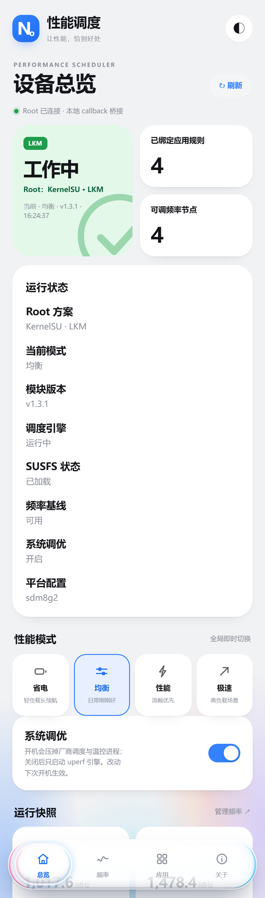
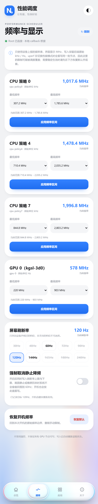
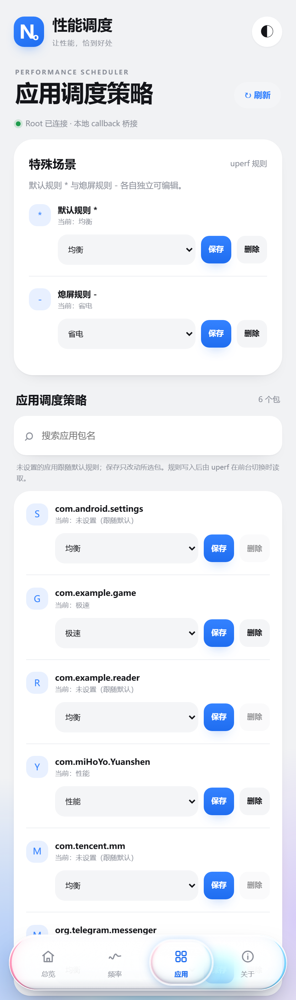
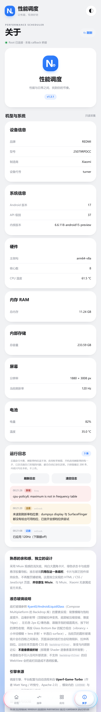
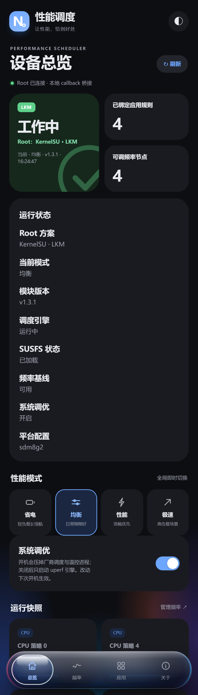

# 南何ovo · 性能调度

基于 [Uperf-Game-Turbo](https://github.com/yinwanxi/Uperf-Game-Turbo) 的 Android 性能调度模块（Magisk / KernelSU / APatch 通用可刷入 zip），自带一套纯本地的 WebUI：全局模式、分应用规则、CPU / GPU 频率区间、屏幕刷新率（含强制取消静止降频）、机型信息与自动运行日志。

界面是 Miuix 观感的白卡 + 悬浮液态玻璃底栏，**不联网、不上传任何数据**。

想直接拿文案去发布，看 [docs/模块介绍.md](docs/模块介绍.md)：一句话版 / 群公告短版 / 发布帖长版，含完整出处表与已知边界。

- 版本：`v1.3.1`（versionCode `20261121`）
- 模块 id：`nanhe_ovo`
- 可刷入包：[`nanhe_ovo-v1.3.1-20261121.zip`](https://github.com/nanhe-ovo/nanhe_ovo-module/releases/download/v1.3.1/nanhe_ovo-v1.3.1-20261121.zip)（1,838 KB / 103 个文件）
- 要求：**arm64** 设备（内置 uperf 与 busybox 只有 aarch64 版本）



## 特性

### 调度

- **全局性能模式**：面板里一排模式卡（常见为省电 / 均衡 / 性能 / 极速，具体取决于 `uperf.json` 的 presets），一点即切换，写入 `/sdcard/Android/yc/uperf/cur_powermode.txt`。
- **分应用规则**：给单个应用绑定调度策略，写进 `perapp_powermode.txt`；应用页可搜索、改绑、删除。
- 包名枚举三路兜底（`pm list packages` / `packages.list` / `dumpsys`），全部失败才留空并记日志。

### 频率

- 只从设备真实的频率表里选最小 / 最大，边界不在表内直接拒绝，写入后回读校验、失败回滚。
- 一键「恢复开机频率」，回到本次开机基线。
- **不做开机持久化**：uperf 切换模式时会重写同一批节点，手动区间可能被调度覆盖（面板内已注明）。

### 刷新率

- 十档候选 `30 / 48 / 60 / 72 / 90 / 120 / 144 / 165 / 180 / 240`，但**只列出设备真正声明过的**：`dumpsys display` 与 `dumpsys SurfaceFlinger` 一起解析，认 `fps=`、`refreshRate=`、`renderFrameRate=`、`framerate=`、`mRefreshRate=`、`vsyncPeriod=`（纳秒换算）与 `1880x3008@120.0Hz` 这类写法。
- 未声明档位：前端虚线置灰不可点，后端同样拒绝（`<HZ> Hz is not supported by this device`）。
- 读不到档位表时不锁死：`status` 给 `refresh_known=0`，前端放开全部十档并提示，写入交由系统决定。
- **强制取消静止降频**：同时钉 `peak_refresh_rate` 与 `min_refresh_rate`，画面静止、熄屏回来不会偷降 60Hz；关闭则删除下限。
- 修复了「开机锁 60Hz」：开机按保存的目标值重写，读不到档位就沿用当前值并写日志。

### 系统调优

默认开启：开机执行 uperf 上游的 `powercfg_once.sh` / `platform_special.sh` / `miui_migt.sh`（压平厂商调度、处理温控进程等）。关闭后只启动 uperf 引擎；状态存于 `/data/adb/nanhe_ovo/tune_disabled`，**改动下次开机生效**。

### 关于页

品牌 / 型号 / 制造商 / 设备代号 / 指纹，Android / API / 安全补丁 / 槽位 / SELinux / Build / 内核，架构 / 核心数 / 硬件 / 主板 / CPU 温度，RAM、存储、屏幕（分辨率 / 密度 / 当前刷新率）、电池（电量 / 温度 / 健康 / 状态 / 技术 / 充电功率）。

### 运行日志

- `/data/adb/nanhe_ovo/log.txt`，一行一条：时间 / 级别（info、warn、error）/ 标签 / 正文，最多 200 行。
- 自动记录：命令失败原文、刷新率档位表或当前值读不到、本次开机没有基线、`uperf.json` 缺失、应用枚举报错、开机应用刷新率的每一步、页面自身发现的问题。
- 同一开机内同类诊断只记一次（按 boot_id 去重）；「清空日志」会连去重标记一起清掉。
- **只写本机，不上传。**

### Root 形态与 SUSFS 状态

- 首页状态卡标签自动显示 `LKM` / `GKI` / `APatch` / `Magisk`：KernelSU 看 `/sys/module/kernelsu` 是否存在来区分 LKM 与内核内置（GKI）；读不到就是「未知」，不硬编码。
- `status` 另输出 `info susfs`：`已加载` / `未加载（SUSFS Guard 已安装）` / `未安装`；已装未加载时自动记一条 warn，指向 `/data/adb/modules/susfs_guard_lkm/load.log`。
- 本模块**不加载、不卸载任何内核模块**，也不写 `kallsyms`、`kptr_restrict`、`/proc/susfs_*`。

### 界面

- 浅灰底 + 纯白 28px 圆角卡；首屏左右分栏（左侧绿色「工作中」状态卡 + Root 形态标签，右侧两枚统计卡），下面竖排「标签 / 值」的运行状态。
- 状态由后端驱动：`uperf` 在跑才显示「工作中」，否则「待机」；桥接不可用显示「只读演示」，不做假成功。
- 底栏是唯一保留玻璃的区域：悬浮胶囊 `blur(22px) saturate(240%)`，上下 16px 折射带、左右 2px 红 / 青色散；镜片随页面滑动，滚动时底栏倾斜 / 拉伸并在停下后弹簧回位。

## 截图

| 首页 | 频率与显示 |
| --- | --- |
|  |  |

| 应用 | 关于 |
| --- | --- |
|  |  |

深色模式：

## 安装

1. 确认设备为 **arm64**（非 arm64 会在安装器里被拒绝）。
2. 管理器刷入 `nanhe_ovo-v1.3.1-20261121.zip`：Magisk → 模块 → 从本地安装；KernelSU / APatch → 模块 → 安装。
3. 重启。
4. 打开面板：KernelSU / APatch 管理器 → 模块 → 南何ovo → 打开 WebUI；Magisk 本体没有模块 WebUI，可用 KsuWebUIStandalone 等工具打开 `/data/adb/modules/nanhe_ovo/webroot/index.html`。

升级会保留 `uperf.json.bak`；卸载会还原 `peak_refresh_rate` / `min_refresh_rate` 并删除 `/data/adb/nanhe_ovo`（含日志）。

## 构建

```powershell
python tools\build.py
```

产物：

- `dist/nanhe_ovo-v1.3.1-20261121.zip` —— 可刷入模块
- `dist/nanhe_ovo-src-v1.3.1.zip` —— 源码包

构建校验：脚本 LF 换行、无 BOM、`#!/system/bin/sh` 首行、zip 内脚本 755、`module.prop` 必填字段；文本写入 zip 时统一转 LF。

## 目录

```
module/       模块内容（即模块 zip 的内容）
tests/        Node 单测、CDP 渲染自检、mock 桥接、POSIX 后端与安装器验证
tools/        build.py（打包与校验）
docs/         截图与介绍词
dist/         构建产物（不入库，见 Releases）
```

## 测试

后端（Ubuntu 22.04，bash + dash）：

```sh
bash tests/shell/run-tests.sh     # 207 PASS / 0 FAIL
```

前端（Windows，Node 22 + 无头 Edge + CDP）：

```powershell
node tests\core.test.cjs         # 命令构造 / 拒绝 / 解析 / 换算 / 桥接
node tests\render.cjs            # 59 项断言 + 5 张截图
```

## 边界（写清楚，免得误会）

1. 不是超频 / 降压 / 改电压工具，只写设备已暴露的频率与刷新率参数。
2. 频率区间不持久化；刷新率有开机应用，但依赖系统设置项被接受。
3. 液态玻璃是 CSS 近似（模糊 + 饱和度 + 边缘色散 + 高光），做不到 Backdrop `lens()` 的逐像素折射。
4. LKM / GKI 判断依据 `/sys/module/kernelsu` 是否存在，属启发式；页面同时显示完整值供比对。
5. APatch / Magisk 只按 `/data/adb/ap`、`/data/adb/magisk` 目录识别，不解析版本号。
6. 日志最多 200 行、只在本机；面板不联网。
7. 未在全部机型验证；当前为 Android 17 / MT8799 真机对照 + Ubuntu 容器后端测试 + Windows 无头 Edge 渲染测试。

## 致谢与出处

完整的引用说明见 [docs/模块介绍.md](docs/模块介绍.md)。

| 引用内容 | 仓库 / 出处 | 许可证 | 用法 |
| --- | --- | --- | --- |
| 调度引擎、平台配置、开机脚本、`system/vendor` 覆盖 | [yinwanxi/Uperf-Game-Turbo](https://github.com/yinwanxi/Uperf-Game-Turbo)（Matt Yang / 吟惋兮） | Apache-2.0 | 模块核心调度，`LICENSE` / `NOTICE` 原样保留 |
| 底栏液态玻璃视觉要素 | [Kyant0/AndroidLiquidGlass](https://github.com/Kyant0/AndroidLiquidGlass) | Apache-2.0 | 仅参考参数，CSS 近似，未打包其代码 |
| 玻璃组件文档（Bottom Bar / lens / vibrancy 参数） | [kyant.gitbook.io/backdrop](https://kyant.gitbook.io/backdrop) | 文档 | 参数与组合方式参考 |
| LKM / GKI 形态与 `/data/adb/ksu`、`ksud` 约定 | [tiann/KernelSU](https://github.com/tiann/KernelSU) | Apache-2.0 | 仅用于理解 Root 形态，未打包代码 |
| 首页状态卡、统计卡、胶囊导航观感 | [SukiSU-Ultra/SukiSU-Ultra](https://github.com/SukiSU-Ultra/SukiSU-Ultra) | GPL-3.0（仅观感） | 版式灵感，不含其代码 |
| Miuix 设计语言（浅灰底 + 白圆角卡） | [compose-miuix-ui/miuix](https://github.com/compose-miuix-ui/miuix) | Apache-2.0 | 仅观感参考，未打包代码，非官方关联 |
| Magisk 模块规范 | [topjohnwu/Magisk](https://github.com/topjohnwu/Magisk) | GPL-3.0 | 刷入与模块目录依据 |
| APatch 模块规范 | [bmax121/APatch](https://github.com/bmax121/APatch) | GPL-2.0 | 同上 |
| Magisk 下打开模块 WebUI | [5ec1cff/KsuWebUIStandalone](https://github.com/5ec1cff/KsuWebUIStandalone) | GPL-3.0 | 安装说明中推荐，未打包 |
| SUSFS Guard (LKM) 的加载流程与错误码 | [inforcqb/susfs4ksu-for-lkm](https://github.com/inforcqb/susfs4ksu-for-lkm) | 见其仓库 | 仅用于理解 `rc=61`（`ENODATA`）与排查路径，不接管 |
| 模块外壳、WebUI、日志、刷新率与频率控制 | 本项目 | Apache-2.0 | 纯本地实现 |

## 许可

Apache License 2.0，见 [LICENSE](LICENSE) 与 [NOTICE](NOTICE)。二次分发请保留原始声明。
